<div align="center">

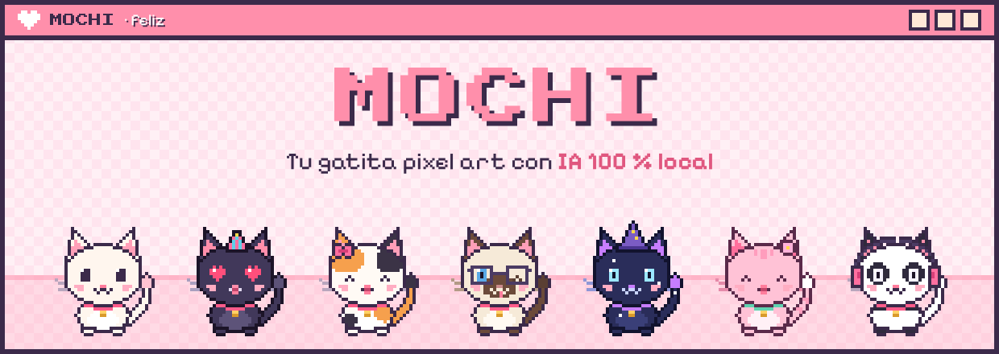

<br>

**Una gatita pixel art que vive en tu escritorio, charla contigo y se acuerda de ti.**<br>
Todo funciona con un modelo de IA que corre en **tu propio ordenador** gracias a [Ollama](https://ollama.com). Sin cuentas, sin nube y sin que nada salga de tu PC.

<br>


<br>


<br>

[**Empezar**](#-empezar-en-1-minuto) ·
[**Qué sabe hacer**](#-qué-sabe-hacer) ·
[**Jugar con Mochi**](#-cómo-jugar-con-mochi) ·
[**Pelajes**](#-15-pelajes-11-accesorios-y-un-montón-de-caras) ·
[**Memoria**](#-memoria-se-acuerda-de-ti) ·
[**Cómo funciona**](#%EF%B8%8F-cómo-está-hecha) ·
[**Problemas**](#-problemas-frecuentes)

<br>

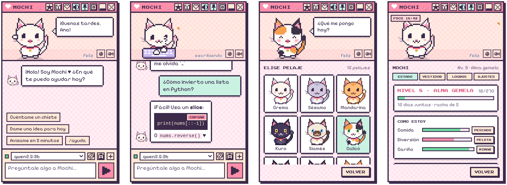

</div>

<br>

## 💡 ¿Qué es Mochi?

Mochi es un **asistente de escritorio con forma de gatita**. Le preguntas cosas y te responde con la IA que tengas instalada en Ollama, pero además **está viva**: te sigue con la mirada, juega con una pelota, se come los pescaditos que le tiras, se duerme si no le haces caso, teclea contigo mientras escribes y tiene su propio nivel de amistad, logros y vestuario.

<table>
<tr>
<td width="33%" align="center"><b>🔒 Privada de verdad</b><br><sub>La IA corre en tu PC con Ollama. Ni una palabra sale de tu ordenador.</sub></td>
<td width="33%" align="center"><b>🖱️ Instalación de doble clic</b><br><sub>En Windows descarga ella sola el motor, Ollama y el modelo, con barras de progreso.</sub></td>
<td width="33%" align="center"><b>🎨 Todo dibujado por código</b><br><sub>Ni una sola imagen: el sprite se genera píxel a píxel en tiempo real.</sub></td>
</tr>
<tr>
<td align="center"><b>🧠 Memoria a largo plazo</b><br><sub>Recuerda tu nombre, tus gustos y tus proyectos, y nunca guarda contraseñas.</sub></td>
<td align="center"><b>⏰ Temporizadores y pomodoro</b><br><sub>«Avísame en 10 minutos de la pizza» y listo, aunque cierres la app.</sub></td>
<td align="center"><b>🐾 Mascota completa</b><br><sub>Necesidades, niveles, 21 logros, 15 pelajes y 11 accesorios.</sub></td>
</tr>
</table>

<br>

## 🚀 Empezar en 1 minuto

### 🪟 Windows (lo más fácil)

> [!TIP]
> **No necesitas Node.js, ni npm, ni permisos de administrador.**

1. Descarga el proyecto (botón verde **Code → Download ZIP**) y descomprímelo.
2. Haz doble clic en **`Iniciar-Mochi.bat`**.

Eso es todo. El resto es gráfico, sin consola:

| Paso | Qué pasa |
|:---:|---|
| **1** | La primera vez, una ventanita rosa descarga el motor de la ventana (**Electron**, ~115 MB), **verifica su SHA-256** contra la lista oficial y lo guarda en `%LOCALAPPDATA%\Mochi`. Las siguientes veces abre directa. |
| **2** | Si no tienes **Ollama**, Mochi te lo ofrece al abrirse: lo descarga con barra de progreso, **comprueba su firma digital**, lo instala en silencio y lo arranca. |
| **3** | Si no tienes ningún **modelo**, te deja elegir uno y lo descarga con barra de progreso. |
| **4** | ¡A charlar! 🐱 |

<div align="center">
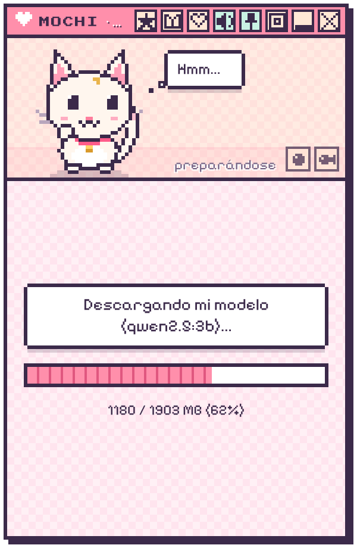
</div>

> [!NOTE]
> La primera vez, Windows SmartScreen puede avisar de que el editor es desconocido (porque el archivo viene de Internet). Pulsa **Más información → Ejecutar de todos modos**. El `.bat` y el `.ps1` son texto plano: puedes leerlos antes.

#### Modelos que te ofrece

| Modelo | Tamaño | Para qué |
|---|:---:|---|
| `llama3.2` | ~2 GB | Equilibrado, la opción por defecto |
| `llama3.2:1b` | ~1,3 GB | Muy ligero, para equipos modestos |
| `qwen2.5:3b` | ~1,9 GB | ⭐ El mejor en español, recomendado |
| `gemma2:2b` | ~1,6 GB | Compacto |

> Si eliges un modelo de programación (`coder`) o uno muy pequeño (`1b`, `1.5b`), Mochi te avisa de que charlará peor y te ofrece cambiar a uno mejor.

### 🍎 macOS / 🐧 Linux

```bash
npm install
npm start
```

Mochi detecta si falta Ollama y te lleva a su web (la instalación automática solo está hecha para Windows). El modelo sí lo descarga ella con barra de progreso.

<details>
<summary><b>📦 Crear un instalador <code>.exe</code> (opcional)</b></summary>

<br>

```bash
npm install
npm run dist
```

Genera un instalador NSIS en `dist/` con **electron-builder**. Con el `.exe`, quien lo use ya no necesita Node.js.

</details>

<details>
<summary><b>🌐 Alternativa sin instalar nada: en el navegador</b></summary>

<br>

Abre `index.html` directamente en el navegador. Para que Ollama acepte la conexión hay que permitir el origen:

| Sistema | Comando |
|---|---|
| Windows (PowerShell) | `setx OLLAMA_ORIGINS "*"` y reinicia Ollama |
| macOS | `launchctl setenv OLLAMA_ORIGINS "*"` y reinicia Ollama |
| Linux | `OLLAMA_ORIGINS="*" ollama serve` |

En este modo no hay instalación automática, avisos del sistema, atajo global ni seguimiento del ratón fuera de la página.

</details>

<br>

## ✨ Qué sabe hacer

<table>
<tr>
<td width="50%" align="center">
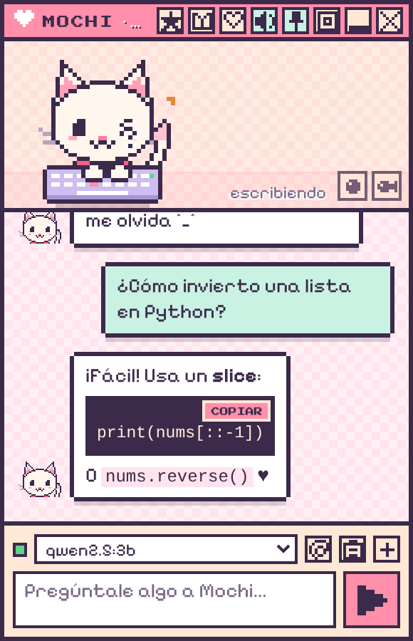<br>
<b>Teclea contigo</b><br>
<sub>Saca un teclado pixel y pulsa una tecla por cada una tuya. Cuando responde, teclea a toda velocidad con letras saliendo volando. El chat entiende <b>Markdown</b> y bloques de código con botón <b>COPIAR</b>.</sub>
</td>
<td width="50%" align="center">
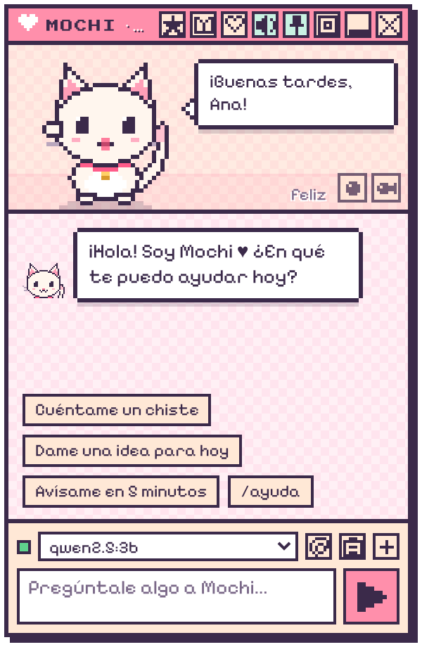<br>
<b>Te saluda por tu nombre</b><br>
<sub>Según la hora («¡Buenos días!», «¿Aún despierto? ♥»), con sugerencias para empezar y respuestas en <i>streaming</i> que puedes parar con <kbd>Esc</kbd>.</sub>
</td>
</tr>
</table>

<table>
<tr>
<td width="50%" align="center">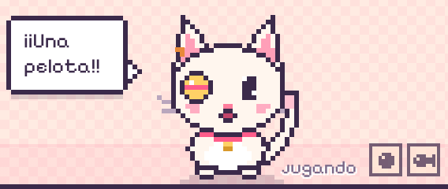<br><b>⚽ Juega a la pelota</b><br><sub>Cógela con el ratón y lánzala: corre, le da zarpazos, salta encima o la empuja con la cabeza. Al rato se cansa.</sub></td>
<td width="50%" align="center">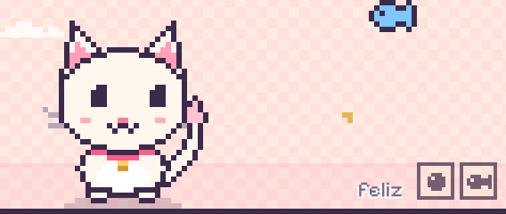<br><b>🐟 Come pescaditos</b><br><sub>Haz clic en el suelo rosa: lo ve caer, salta a por él y se lo come (¡ñam!). Con 4 seguidos está llenísima.</sub></td>
</tr>
<tr>
<td align="center">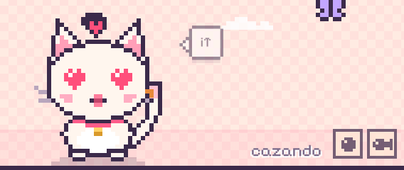<br><b>💕 Reacciona a todo</b><br><sub>Clic en la cara, en la barriga o en la cola: amor, cosquillas o un bufido con la cola erizada.</sub></td>
<td align="center">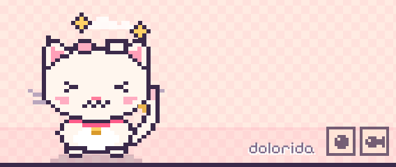<br><b>💫 Chichones y mareos</b><br><sub>Un clic en la coronilla le saca un chichón y se frota con la pata. Cinco clics seguidos y acaba mareada.</sub></td>
</tr>
<tr>
<td align="center">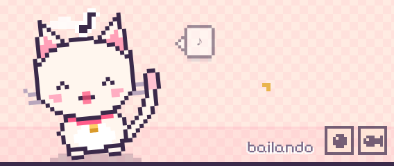<br><b>🎵 Baila</b><br><sub>Escríbele «baila» o usa <code>/baila</code>. También lo celebra cuando subes de nivel.</sub></td>
<td align="center">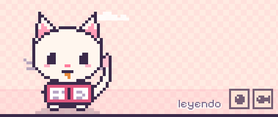<br><b>📖 Tiene vida propia</b><br><sub>Sola lee, toma leche, amasa, se estira, persigue mariposas, estornuda, se acicala… y al final se duerme.</sub></td>
</tr>
</table>

<br>

## 🐾 Cómo jugar con Mochi

| Haces… | Mochi… |
|---|---|
| 🖱️ **Clic en la cara** | Reacciona de 6 formas: parpadeo lento (un «te quiero» gatuno), ojos de corazón, guiño, susto, «¡nya!» o un saltito |
| 🤕 **Clic en la coronilla u orejas** | ¡Golpe! Cierra los ojos `> <`, le sale un chichón, se frota con la pata y a veces llora |
| 😹 **Clic en la barriga** | Se ríe por las cosquillas y se menea |
| 😾 **Clic en la cola** | Se enfada, eriza la cola y bufa |
| 💫 **5 clics seguidos** | Se marea (ojos en X y estrellitas girando) |
| 🤚 **Ratón de lado a lado sobre su cabeza** | Ronronea, inclina la cabeza y suelta notas y corazones |
| 🤸 **Doble clic** | Da una voltereta (en modo mini, vuelve al chat) |
| ✋ **Arrastrarla** | Mueves la ventana; ella se balancea mientras vuela |
| 👀 **Mover el ratón por la pantalla** | Te sigue con la mirada, incluso fuera de su ventana |
| 🐭 **Mover mucho el ratón por el escenario** | Modo caza: se agazapa meneando el culete y salta hacia el cursor |
| ⌨️ **Escribir** | Saca un teclado pixel y teclea contigo |
| 🤔 **Esperar su respuesta** | Piensa con la pata en la barbilla; luego teclea la respuesta a toda velocidad |
| ⌫ **Borrar mucho con Retroceso** | Se ríe de ti («¡borra, borra!») |
| 💬 **Escribirle «gracias», «te quiero», «jaja», «baila», «hola», «adiós», «estoy triste», «miau»…** | Reacciona al instante con corazones, risas, baile, saludo o consuelo |
| 😿 **Dejarla con hambre, aburrida o sin cariño** | Te lo dice: le ruge la tripa, saca ella sola la pelota o te pide un mimo |

### ⌨️ Atajos

| Tecla | Acción |
|:---:|---|
| <kbd>Enter</kbd> | Enviar |
| <kbd>Shift</kbd> + <kbd>Enter</kbd> | Salto de línea |
| <kbd>Esc</kbd> | Detener la respuesta |
| <kbd>Ctrl</kbd> + <kbd>Shift</kbd> + <kbd>M</kbd> | Mostrar u ocultar a Mochi desde cualquier sitio |

### 🎛️ La barra de arriba

`⭐ Vida` · `📖 Memoria` · `💗 Pelaje` · `🔊 Sonido` · `📌 Siempre visible` · `▣ Modo mini` · `▁ Minimizar` · `✕ Cerrar`

Recuerda la conversación, el pelaje, el modo y la posición de la ventana entre sesiones.

<br>

## 🎨 15 pelajes, 11 accesorios y un montón de caras

<div align="center">
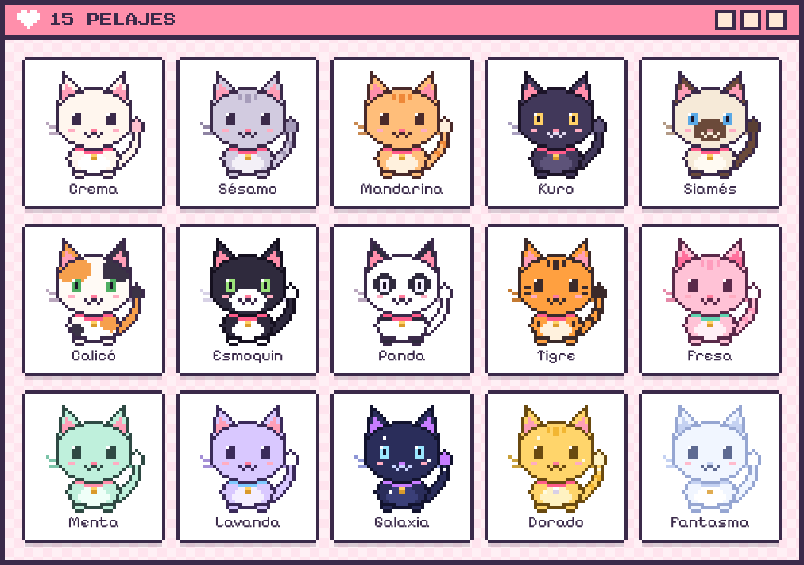
</div>

<sub>El botón del corazón abre un selector con vista previa. <b>Galaxia</b> tiene estrellitas que brillan, <b>Dorado</b> destella y <b>Fantasma</b> es semitransparente y flota.</sub>

<br><br>

<div align="center">
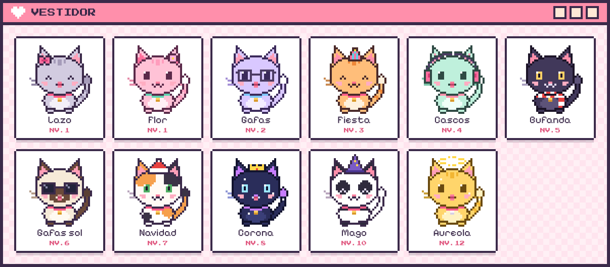
</div>

<sub>Los accesorios se desbloquean al subir el nivel de amistad y se combinan con cualquier pelaje.</sub>

<br><br>

<div align="center">
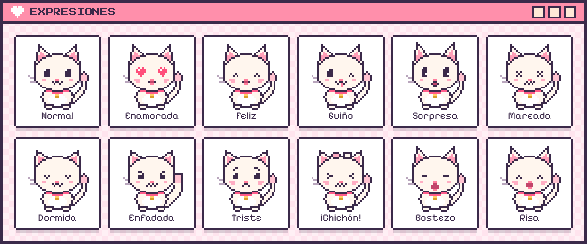
</div>

<sub>Ojos, boca, orejas, cola, patitas y coloretes se combinan en tiempo real. Todo sale del mismo motor de dibujo procedural.</sub>

<br>

## ⭐ Vida de Mochi

El botón de la estrella abre su panel de vida, con cuatro pestañas:

<table>
<tr>
<td align="center" width="25%">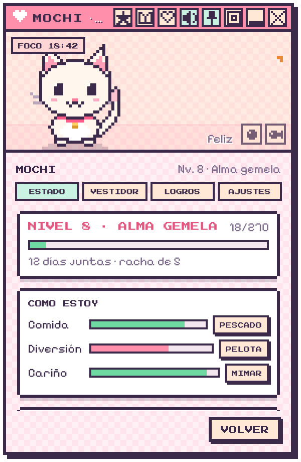<br><b>Estado</b></td>
<td align="center" width="25%">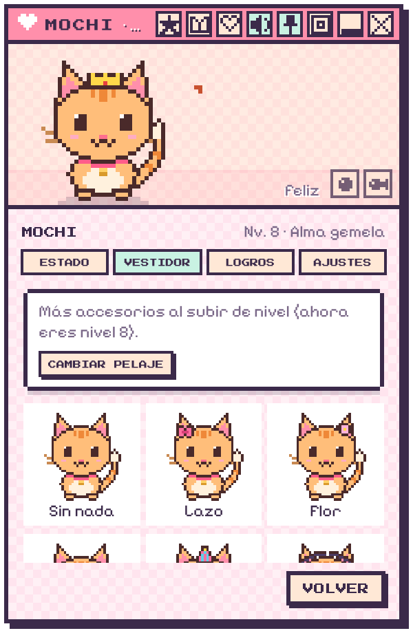<br><b>Vestidor</b></td>
<td align="center" width="25%">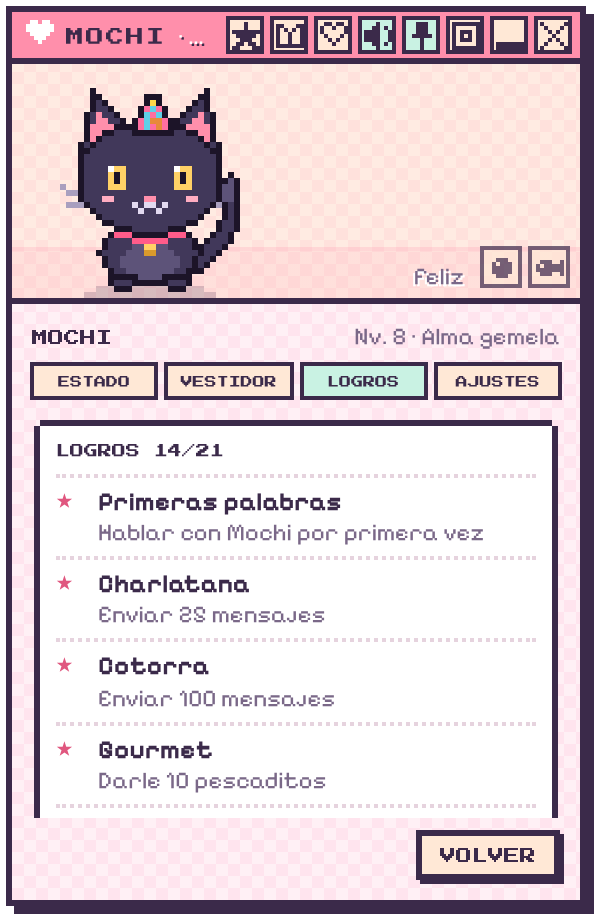<br><b>Logros</b></td>
<td align="center" width="25%">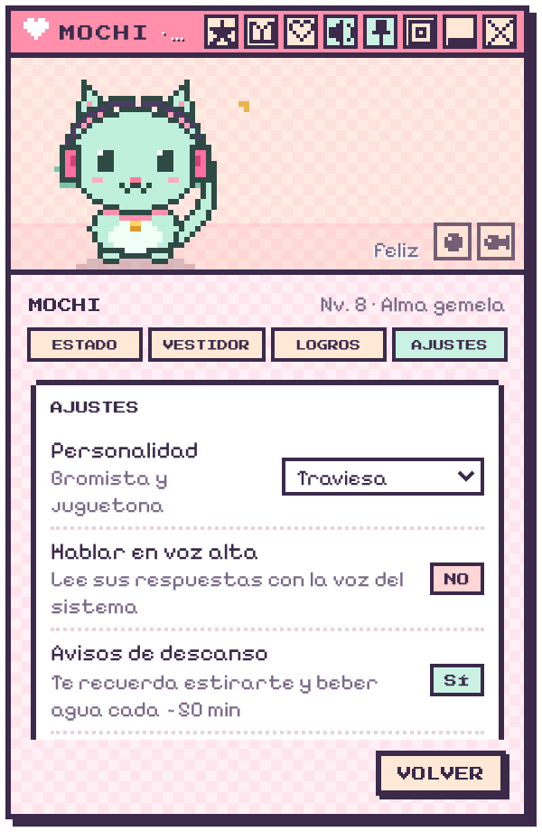<br><b>Ajustes</b></td>
</tr>
</table>

- **🍽️ Necesidades**: comida, diversión y cariño bajan con el tiempo. Las subes desde el propio panel (pescado, pelota, mimar). Con la app cerrada se desgastan muy despacio y nunca llegan a lo peor.
- **📈 Niveles**: suben con cada interacción. Cada nivel trae un título: *Conocida → Amiga → Buena amiga → Mejor amiga → Compañera → Inseparable → Alma gemela → Familia → Leyenda*.
- **🏆 21 logros** con aviso en pantalla: hablar por primera vez, 10 pescaditos, un pomodoro, charlar de madrugada…
- **⚙️ Ajustes**: personalidad (**Dulce, Traviesa, Profe, Directa o Zen**), leer las respuestas en voz alta, avisos de descanso y abrir Mochi al iniciar el ordenador.

<br>

## ⏰ Avisos, temporizadores y comandos

Escríbele cosas como *«avísame en 10 minutos de sacar la pizza»* o usa un comando. Al terminar, Mochi salta, suena una alarma, aparece en pantalla aunque esté minimizada y parpadea en la barra de tareas. **Los avisos sobreviven aunque cierres la app.**

| Comando | Qué hace |
|---|---|
| `/temporizador 10 pizza` | Aviso en 10 min con etiqueta (acepta `90s`, `1h30m`, `media hora`…) |
| `/pomodoro` · `/pomodoro stop` | 25 min de foco y 5 de descanso (15 cada 4 rondas). Mochi se queda calladita mientras trabajas |
| `/parar` · `/avisos` · `/estado` | Cancela los avisos · los lista · te dice cómo está Mochi |
| `/pelota` · `/pescado` · `/baila` | Juegos rápidos |
| `/pelaje siamés` · `/sombrero corona` | Cambia de pelaje o de accesorio |
| `/portapapeles` | Lee lo último que copiaste |
| `/ayuda` | Lista de comandos |

> [!TIP]
> Estos comandos **no pasan por la IA**: funcionan al instante y aunque no tengas ningún modelo.

**🧘 Descanso:** si lo activas, tras unos 50 minutos seguidos usando el ordenador te recuerda estirarte, beber agua o descansar la vista. Si te vas un rato, se duerme; cuando vuelves, te saluda.

<br>

## 🧠 Memoria: se acuerda de ti

<table>
<tr>
<td width="300" valign="top">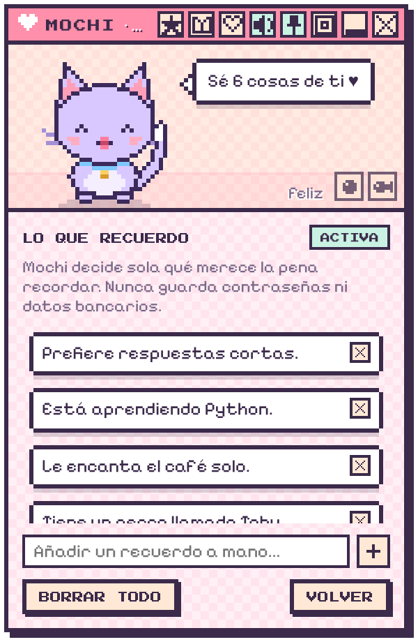</td>
<td valign="top">

Después de cada respuesta, la misma IA local revisa tu último mensaje y **decide si merece la pena recordarlo**.

✅ **Sí guarda:** tu nombre, edad, dónde vives o trabajas, gustos, mascotas, familia, proyectos largos y cómo prefieres que te responda.

➖ **No guarda:** preguntas sueltas, estados de ánimo pasajeros ni cosas repetidas.

⛔ **Nunca guarda:** contraseñas, PIN, tarjetas, cuentas ni documentos de identidad. **Lo bloquea también el código**, aunque la IA se equivoque.

🛡️ **Anti-invenciones:** solo acepta recuerdos que salgan de verdad de lo que escribiste.

✏️ Si corriges un dato, lo **actualiza**; si le dices «olvida…», lo **borra**.

Cada vez que aprende algo aparece una línea amarilla en el chat (`✎ Recordado: …`). Con el botón del **libro** ves todo lo que sabe, puedes borrar recuerdos uno a uno, añadirlos a mano o apagar la memoria.

</td>
</tr>
</table>

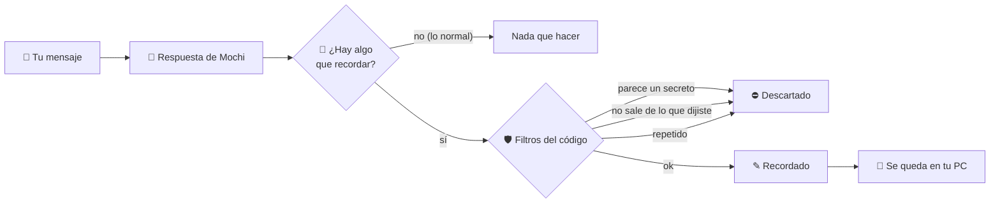

<details>
<summary><b>🔬 Trucos para que funcione bien con modelos pequeños</b></summary>

<br>

- Tu **nombre** lo capta al instante («me llamo…», «llámame…») sin esperar a la IA, y antes de responder espera a que termine de guardar lo pendiente, para usarlo ya en la siguiente respuesta.
- Los modelos pequeños se fijan poco en las instrucciones iniciales, así que además **le recuerda tus datos justo al lado de tu pregunta**, sin guardarlo en el historial.
- El evaluador pide la salida con un **esquema JSON** (`add` / `update` / `remove`) y temperatura 0. Si el modelo no admite esquemas, recurre a `format: "json"`.

</details>

<br>

## 📄 Que lea tus cosas

**Arrastra un archivo de texto o código** (`.txt`, `.md`, `.py`, `.js`, `.json`, `.csv`…) sobre Mochi, o un trozo de texto seleccionado. Se lo «come» y te ofrece:

<div align="center">

`Resumir` · `Explicar` · `Traducir` · `Corregir`

</div>

- Si arrastrar no funciona en tu equipo, usa el botón del **clip** o copia el archivo en el Explorador y pégalo con <kbd>Ctrl</kbd>+<kbd>V</kbd> en la caja de texto.
- El botón del **portapapeles** hace lo mismo con lo último que hayas copiado.
- Acepta texto y código aunque la extensión sea rara; rechaza PDF, Word, imágenes y archivos de más de ~400 KB.
- Solo se envía a tu IA local: **nada sale de tu ordenador.**

<br>

## 🌙 Día, noche, estaciones y modo mini

<table>
<tr>
<td width="65%" align="center">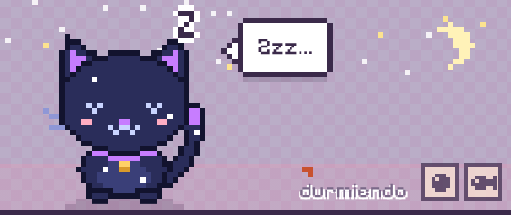<br><sub>A partir de las 22:00 el escenario se oscurece, salen las estrellas y la luna, se duerme antes y a veces pide un deseo a una estrella fugaz. En <b>otoño</b> caen hojas, en <b>invierno</b> nieva y en <b>primavera</b> caen pétalos.</sub></td>
<td width="35%" align="center">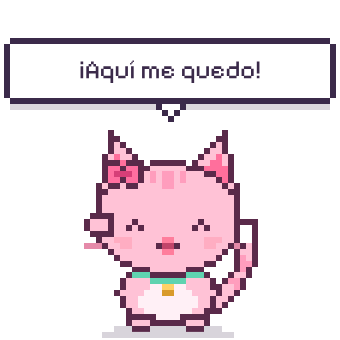<br><sub><b>Modo mini</b>: solo la gatita flotando sobre tu escritorio, sin ventana. Arrástrala donde quieras y haz doble clic para volver al chat.</sub></td>
</tr>
</table>

<br>

## 🏗️ Cómo está hecha

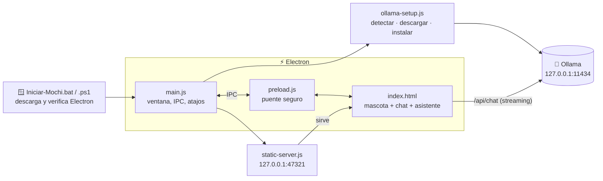

| Archivo | Qué hace |
|---|---|
| `Iniciar-Mochi.bat` / `.ps1` | Lanzador de Windows: descarga Electron con una ventana gráfica, comprueba el SHA-256 y abre Mochi |
| `main.js` | Ventana sin marco y transparente, modo mini, posición recordada, atajo global, seguimiento del cursor, avisos e IPC |
| `ollama-setup.js` | Detectar, descargar (solo https), verificar la firma, instalar y arrancar Ollama |
| `static-server.js` | Sirve `index.html` en `127.0.0.1` para que Ollama acepte la conexión (con `file://` el origen es `null`) |
| `preload.js` | Puente seguro entre la página y Electron |
| `index.html` | Toda la interfaz: motor del sprite, partículas, sonido sintetizado, chat, memoria, vida y asistente de instalación |

<details>
<summary><b>🎨 Cómo se dibuja el sprite</b></summary>

<br>

Mochi **no usa ni una sola imagen**. Cada fotograma se calcula en un lienzo de **40 × 36 píxeles** que se escala ×3:

1. El cuerpo se describe con **formas geométricas** (elipses para cabeza y cuerpo, triángulos para las orejas y una curva de Bézier hecha de círculos para la cola).
2. Cada píxel se asigna a la forma de más arriba y se le pone **contorno automático** donde cambia de forma.
3. Encima se pintan barriga, manchas del pelaje, collar con cascabel, bigotes, coloretes, ojos, boca y accesorios.
4. Saltos, aplastamientos y giros usan **muelles físicos**, y las partículas (corazones, notas, estrellas, Zzz…) son mini-sprites con contorno.

Por eso las expresiones, la cola y las orejas se animan sin imágenes, y añadir un pelaje nuevo es cuestión de unos pocos colores. Los sonidos también son **sintetizados con Web Audio**, sin archivos.

</details>

<details>
<summary><b>🔒 Seguridad</b></summary>

<br>

- La ventana usa `contextIsolation`, `sandbox` y **sin** `nodeIntegration`. La página solo habla con Electron a través de `preload.js`.
- Cada mensaje IPC comprueba que viene del origen local de confianza; las rutas de navegación externas y las ventanas nuevas están bloqueadas.
- El servidor local solo escucha en `127.0.0.1` y solo sirve `index.html`.
- Electron se verifica contra el `SHASUMS256.txt` oficial de la release.
- El instalador de Ollama solo se descarga por **https** y **no se ejecuta** si su firma Authenticode no es válida.
- La memoria filtra contraseñas, PIN, tarjetas, IBAN, DNI/NIE y similares por código, diga lo que diga la IA.

</details>

<br>

## 🛠️ Personalizar

Casi todo está en `index.html`:

| Qué | Dónde |
|---|---|
| Nombre y personalidad base | `PET_NAME`, `SYSTEM_PROMPT` |
| Personalidades, accesorios y logros | `PERSONAS`, `HATS`, `ACHS` (añade los tuyos) |
| Colores de cada pelaje | `SKINS` |
| Cuánto tarda en dormirse | `SLEEP_AFTER_MS` |
| Cuánta conversación recuerda | `MAX_HISTORY` / `SAVED_MESSAGES` |
| Frases de cada reacción | `reactHead`, `reactBelly`, `reactTail`… |
| Modelos que ofrece el asistente | `<select id="pull-model">` |
| Tamaño de la ventana | `SIZES` en `main.js` |

<br>

## 🩹 Problemas frecuentes

<details>
<summary><b>«No pude arrancar Ollama»</b></summary>
<br>
Ábrelo a mano desde el menú Inicio y pulsa <b>REINTENTAR</b>.
</details>

<details>
<summary><b>El instalador de Ollama no pasa la comprobación de firma</b></summary>
<br>
Mochi se niega a ejecutarlo por seguridad. Usa el botón <b>ABRIR WEB</b>, instala Ollama a mano y vuelve a abrir Mochi.
</details>

<details>
<summary><b>«electron.exe desapareció…» o Electron no se instala</b></summary>
<br>
Casi siempre es el antivirus borrando <code>electron.exe</code> al extraerlo. Añade la carpeta <code>%LOCALAPPDATA%\Mochi</code> (y la de Mochi) a las exclusiones de <b>Seguridad de Windows → Protección antivirus → Exclusiones</b> y vuelve a abrir Mochi. Para empezar de cero, borra <code>%LOCALAPPDATA%\Mochi</code>.
</details>

<details>
<summary><b>Falla la descarga de Electron</b></summary>
<br>
El lanzador la hace desde GitHub. Si tu red lo bloquea, instala Node.js y ejecuta <code>npm install</code> y <code>npm start</code> en la carpeta (el lanzador también detecta <code>node_modules\electron</code> si existe).
</details>

<details>
<summary><b><code>npm install</code> falla</b></summary>
<br>
Suele ser por falta de conexión o por un antivirus o proxy que bloquea la descarga de Electron desde GitHub.
</details>

<details>
<summary><b>No puedo arrastrar archivos sobre Mochi</b></summary>
<br>
Suelta siempre sobre Mochi o el chat, no sobre la barra rosa de arriba (esa zona solo sirve para mover la ventana). Si Mochi está abierta como administrador, Windows no deja arrastrar desde el Explorador normal. Como alternativa, usa el botón del clip o <kbd>Ctrl</kbd>+<kbd>V</kbd>.
</details>

<br>

## 📜 Créditos

- Fuentes pixel **[Pixelify Sans](https://fonts.google.com/specimen/Pixelify+Sans)** y **[Press Start 2P](https://fonts.google.com/specimen/Press+Start+2P)**, con licencia SIL Open Font License 1.1, incrustadas en `index.html` (ver `FONTS-LICENSE.txt`).
- IA local gracias a **[Ollama](https://ollama.com)**; ventana con **[Electron](https://www.electronjs.org)**.

<br>

<div align="center">

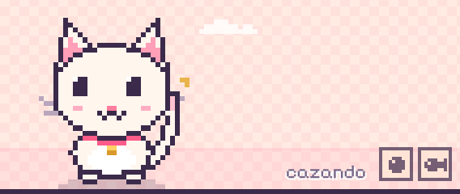

<sub>Hecho con ♥ y muchos píxeles. Si te gusta, ¡dale una ⭐ al repo para que Mochi suba de nivel!</sub>

</div>